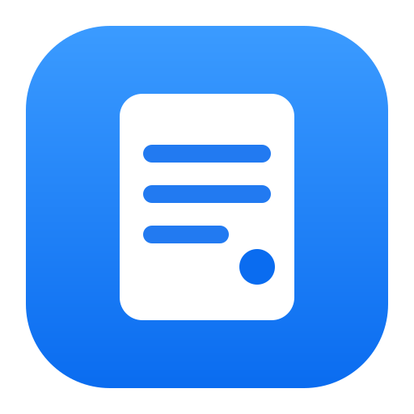

<div align="center">



# Studio

**Notes, tâches, projets et agents IA au même endroit — chiffrés, sur tes appareils, sans serveur.**

[](https://github.com/MTthoas/Studio/actions/workflows/build.yml)
[](https://github.com/MTthoas/Studio/releases/latest)
[](LICENSE)


[Démarrer](#démarrage-rapide) · [Fonctionnalités](#fonctionnalités) · [Sécurité](#sécurité-et-vie-privée) · [Développement](#développement) · [Contribuer](#contribuer)

</div>

---

Studio est un carnet de notes Markdown reliées entre elles, qui réunit aussi tes tâches, tes tickets Linear, tes dépôts GitHub et tes agents Claude Code. Tout est stocké sur tes appareils : pas de compte, pas de backend, aucune dépendance à l'exécution.

- **Écrire** — des notes en texte simple, reliées comme un wiki personnel (`[[liens]]`, `#tags`, graphe).
- **Centraliser** — tâches, tickets Linear, pull requests et CI GitHub à côté de tes notes.
- **Automatiser** — décris une routine une fois ; l'IA l'exécute à heure fixe ou à chaque événement, avec ton accord pour toute écriture.
- **Piloter** — confie une consigne à Claude Code dans une copie isolée du dépôt, relis, publie en pull request.

## Sommaire

- [Démarrage rapide](#démarrage-rapide)
- [Fonctionnalités](#fonctionnalités)
  - [Notes et blocs spéciaux](#notes-et-blocs-spéciaux)
  - [Tâches](#tâches)
  - [Projets](#projets)
  - [Agents Claude Code](#agents-claude-code)
  - [Serveurs et pilotage à distance](#serveurs-et-pilotage-à-distance)
  - [Automatisations](#automatisations)
  - [Intelligence artificielle](#intelligence-artificielle)
  - [Synchronisation entre appareils](#synchronisation-entre-appareils)
- [Sécurité et vie privée](#sécurité-et-vie-privée)
- [Développement](#développement)
- [Contribuer](#contribuer)
- [Licence](#licence)

## Démarrage rapide

| Plateforme | Prérequis | Installation |
| --- | --- | --- |
| **Web** | Node.js ≥ 22.18 | `npm install && npm run serve` |
| **Mac** | macOS 13+, outils en ligne de commande d'Apple | `./native/build-mac.sh --install`, ou `Studio-macOS.zip` depuis les [Releases](https://github.com/MTthoas/Studio/releases/latest) |
| **iPhone / iPad** | iOS 16+, Xcode avec la plateforme iOS | `./native/iphone.sh` |

### Web

```bash
npm install          # TypeScript et esbuild (outils de développement uniquement)
npm run serve        # build en continu + http://localhost:8000
```

Les modules JavaScript et le chiffrement demandent `http://localhost` ou HTTPS : ouvrir `index.html` directement ne suffit pas.

L'app s'installe comme une application à part entière et fonctionne hors ligne :

- **Safari** : Fichier → « Ajouter au Dock ». **Chrome** : ⋮ → « Installer Studio ».
- Clic droit sur l'icône du Dock : Capture rapide, Nouvelle note, Aujourd'hui.

### Mac

```bash
./native/build-mac.sh --install
```

Construit `Studio.app` (binaire universel Apple Silicon et Intel, ~1 Mo) et l'installe dans `/Applications`. L'app embarque ses fichiers : rien n'est mis en ligne, aucun serveur. Chaque push produit aussi l'app dans l'onglet *Actions* de GitHub, et chaque version est publiée dans les *Releases*.

### iPhone / iPad

1. Installe Xcode (App Store) et la plateforme iOS (Xcode → Settings → Components).
2. Ajoute ton identifiant Apple dans Xcode → Settings → Accounts.
3. Branche l'iPhone, puis lance `./native/iphone.sh` : l'app est compilée et installée sans ouvrir Xcode.

Avec un identifiant Apple gratuit, Apple impose de réinstaller l'app tous les 7 jours. Les deux apps se relient ensuite par Réglages → Appareils.

### Commande `studio`

```bash
ln -sf "$PWD/bin/studio" ~/.local/bin/studio   # une seule fois (un dossier présent dans le PATH)

studio           # ouvre l'app Mac (la construit et l'installe si elle manque)
studio web       # version web en local, reconstruite à chaque modification
studio update    # reconstruit l'app Mac depuis les sources et la réinstalle
studio help      # aide
```

**Mises à jour** — la version web se met à jour seule à chaque ouverture. L'app Mac, qui embarque ses fichiers, se met à jour depuis Réglages → **Mises à jour** : elle lit la dernière [Release](https://github.com/MTthoas/Studio/releases/latest) du dépôt (au lancement puis toutes les 6 heures, désactivable), le signale dans la barre latérale, et sur ton clic télécharge `Studio-macOS.zip`, vérifie le paquet (même identifiant, signature intacte), remplace l'app et la relance. Rien n'est installé sans clic. L'app n'étant pas signée par un compte développeur Apple, macOS peut redemander certains accords (trousseau, micro) après une mise à jour. `studio update` reste la voie pour installer ce que tu as modifié en local.

## Fonctionnalités

Dans l'app, la page **Aide** (touche `?`) explique la prise en main en cartes courtes, et l'accueil propose des **premiers pas** qui se cochent d'eux-mêmes.

### Notes et blocs spéciaux

Les notes sont du Markdown : `[[Titre]]` crée un lien (chaque note montre qui la cite, le graphe dessine l'ensemble), `#tag` range la note sans dossier, et une capture sans tag arrive dans la boîte de réception. Chaque note garde son historique de versions, et peut être **éphémère** : elle s'efface seule à la date choisie.

| Écriture | Effet |
| --- | --- |
| `` `= 1200 * 12` `` | Calcul dans le texte |
| `[timer 25m]` | Minuteur dans la note |
| ` ```sql ` / ` ```schema ` | Diagramme entité-association ; export SQL, Mermaid, SVG |
| ` ```agent ` | Automatisation IA (outils : `notes`, `linear`, `agents`), lançable ou planifiée |
| ` ```linear ` | Liste d'issues Linear filtrée (assigné, état, équipe…) |
| ` ```projet ` | Déclare un [projet](#projets) |

Sur iPhone, le bouton micro transforme ta voix en note ; la transcription est faite sur l'appareil.

### Tâches

La page **Tâches** (`⇧⌘T`) réunit une liste dédiée — « Appeler Paul demain » crée une tâche avec échéance — et les cases à cocher de toutes les notes. Les tâches sont stockées dans une note Markdown « Tâches » : chiffrées, synchronisées et versionnées comme le reste.

- **Liste ou Kanban** (À faire, En cours, Terminées) : glisser-déposer, ou boutons ‹ › au clavier et au doigt. Une tâche en cours s'écrit `- [/]`.
- **Linear** : la même page montre tes tickets et chacune de tes vues Linear enregistrées ; déplacer une carte change l'état du ticket dans Linear.
- **Filtre par projet**, en liste comme en Kanban.

### Projets

Un **projet** réunit son dossier sur le Mac, son ou ses dépôts GitHub, son projet Linear, ses tâches et ses notes. C'est une note qui contient un bloc :

````markdown
```projet
nom: Studio
dépôts: MTthoas/Studio
linear: Studio
site: https://studio.exemple.com
```
````

Une note ou une tâche y appartient avec le tag `#projet/studio` — posé par le bouton **Projet** de l'éditeur, le menu d'une tâche, ou en créant depuis la page du projet. Chaque projet a ses onglets, aussi listés dans la barre latérale :

| Onglet | Ce qu'on y trouve |
| --- | --- |
| **Vue d'ensemble** | Une carte par onglet, des graphiques (commits par jour, tokens Claude Code par jour, santé de la CI, avancement des tâches), une barre de consigne rapide et les agents en cours |
| **Claude Code** | Les agents et les sessions menées dans le dossier, en direct : ce qu'elles font, fichiers modifiés, tokens consommés. Chaque conversation porte un nom court qui la résume (rédigé par l'IA branchée dans Studio, remis à jour quand elle avance), apparaît dans la barre latérale et le fil d'Ariane, et peut être arrêtée ou supprimée (son journal part à la corbeille du Mac). Sous la consigne, ce qu'il reste de ton abonnement Claude en pourcentage (session de 5 heures, semaine) et le délai avant réinitialisation |
| **Code** | Dossier local, branches locales (avance / retard), PR et activité, **revue IA** des changements en cours ou de la branche ; ouverture dans VS Code, le Finder ou le Terminal |
| **Flux** | Le parcours de chaque branche façon gitflow : en cours → PR ouverte → prête à fusionner → fusionnée → publiée (Release), avec CI et revues |
| **Serveur** | L'état du VPS ou de la VM du projet, joint en SSH, et ses agents |
| **Tâches · Notes** | Ce qui est tagué `#projet/<nom>` |
| **Site** | Le site du projet, vérifié depuis le Mac (en ligne, code, temps de réponse) |

- Le **dossier local** est choisi dans le sélecteur de macOS et reste dans les réglages de l'app Mac : il n'est jamais écrit dans une note ni synchronisé. L'app n'en lit l'état Git qu'en lecture seule.
- **Revue IA** : le diff est lu en local, montré, puis envoyé à l'IA branchée seulement après ton clic ; la revue peut être enregistrée comme note du projet.
- **Sessions** : l'app Mac lit les journaux locaux de Claude Code (`~/.claude/projects/…`), en lecture seule ; rien ne quitte la machine.

### Agents Claude Code

Dans l'onglet **Claude Code** d'un projet, tu écris une consigne, Claude Code travaille dans le dépôt, et tu suis tout en direct (app Mac).

- **Modifier** : l'agent travaille dans une **copie isolée** du dépôt (worktree Git dans `.claude/worktrees/`, exclue de `git status`). Ton dossier n'est jamais touché. Ensuite : **Revue** IA, **VS Code**, **Publier** ou **Supprimer**.
- **Analyser** : lecture seule, Claude Code explore et propose.
- **Notes et tâches** : joins des notes du projet à une consigne (« Joindre une note »), ou confie directement une note (bouton **Claude Code** de l'éditeur, onglet Notes) ou une tâche (onglet Tâches).
- **Sessions** : toutes les sessions Claude Code du projet, y compris celles lancées hors de Studio, avec leur fil, les fichiers touchés et les tokens ; chacune peut être **reprise**.
- **Sous-agents** : les tâches que Claude délègue pendant une conversation apparaissent dans son en-tête. Un clic ouvre le fil du sous-agent (lecture seule), le fil d'Ariane suit (… › conversation › sous-agent), on passe d'un sous-agent à l'autre, et **Épingler** le garde dans la barre latérale, sous sa conversation.

**Publier** transforme une copie en pull request, en un clic. Studio propose le message de commit au format [Conventional Commits](https://www.conventionalcommits.org/fr/) (`feat`, `fix`, `chore`…), rédigé par l'IA d'après la consigne, le compte rendu de l'agent et le diff, dans le style des commits récents, puis un nom de branche assorti (`feat/…`). Un orchestrateur enchaîne ensuite seul :

1. la mise à jour de la copie sur la dernière version de la branche principale distante, sans commit de fusion ;
2. en cas de conflit, la reprise de la session de l'agent qui a écrit la copie pour qu'il le résolve (deux essais) ;
3. la vérification qu'aucun marqueur de conflit ne reste ;
4. un seul commit, puis le push (`--force-with-lease`) et l'ouverture de la pull request.

Si l'agent ne parvient pas à résoudre, la publication s'arrête et te donne la liste des fichiers en conflit. Une seule tâche tourne à la fois par copie, et elle continue même si la fenêtre de publication est fermée. Le jeton GitHub a besoin de « Pull requests : lecture et écriture » pour ouvrir la PR ; sans ce droit, Studio ouvre la page de la PR sur GitHub, déjà remplie.

**Déjà livré, plus reproposé** : Studio relit le dépôt distant (au plus toutes les 90 s, et à la fin de chaque discussion avec un agent) et reconnaît une branche fusionnée dans la branche principale, qu'elle l'ait été par merge, rebase ou squash. Une copie fusionnée sans nouveau travail n'est plus proposée à la publication : elle repart d'elle-même de la dernière version de la branche principale, sur une nouvelle branche. Une même discussion peut ainsi livrer **plusieurs branches** ; **Nouvelle branche** fait la même chose sans attendre la fusion (la branche poussée garde sa PR). Les branches livrées par chaque copie s'affichent sous elle, fusionnées ou en attente.

**Messages en attente** : pendant qu'un agent travaille, tu peux continuer à lui écrire. Tes messages s'affichent « en attente » dans le fil (tu peux en retirer un) et lui sont remis ensemble, en une seule consigne, dès qu'il a fini son tour : dans l'ordre, chacun délimité, avec la règle « le plus récent l'emporte » s'ils se contredisent. Studio ne coupe jamais l'agent en plein travail. S'il s'est arrêté ou a échoué, les messages restent en attente jusqu'à ce que tu cliques sur **Envoyer maintenant** ou que tu répondes.

**Garde-fous** : `--restricted` (fichiers confinés au dossier de travail), `--permission-mode dontAsk` et une liste explicite d'outils (lecture, écriture). Aucune commande ne s'exécute, sauf si tu coches **Tests npm** (`npm test`, `npm run …`). Pas de réglages, hooks ni serveurs MCP de l'utilisateur ; trois agents au plus, 90 minutes au plus.

### Serveurs et pilotage à distance

**Serveur** (VPS, VM) : relie un hôte SSH (alias de `~/.ssh/config` ou `utilisateur@hôte`) et le dossier du projet sur ce serveur. Studio affiche son état (charge, mémoire, disque, dépôt, Claude Code), ouvre un terminal SSH, et y lance des agents Claude Code avec les mêmes garde-fous. Connexion par clé uniquement (`BatchMode`) : Studio ne stocke ni ne voit aucune clé. Les commandes distantes sont fixes et protégées, et la configuration reste dans l'app Mac.

**À distance** : depuis l'iPhone (ou un autre ordinateur) lié au Mac, tu suis les agents, lances une consigne, reprends ou arrêtes une session — via la liaison chiffrée de bout en bout. Sur le Mac, chaque appareil doit être autorisé (Réglages → Appareils → « Peut piloter Claude Code sur ce Mac ») ; seules ces actions passent, jamais les commandes ni la publication, et chacune est signalée sur le Mac. Studio doit rester ouvert sur le Mac.

### Automatisations

Une **automatisation** est une consigne en langage naturel, écrite dans une note, que l'IA exécute avec des outils — lire et ranger les notes, créer des tâches, lire l'activité Linear et GitHub, ouvrir des tickets.

````markdown
```agent
nom: Tri des captures
outils: notes
déclencheur: capture
---
Range la capture sous les bons tags
et ajoute les actions à mes tâches.
```
````

- **Quand** : à la demande, à heure fixe (`planning: jours ouvrés 9h`, `vendredi 17h`, `toutes les 2h`), ou à chaque événement (`déclencheur: capture`, `linear`, `github`, `tâche`).
- **Sûreté** : toute écriture est soumise à ton accord ; le contenu des notes et des événements est transmis comme donnée, jamais comme consigne.
- **Page Automatisations** : modèles prêts à l'emploi (revue du matin, tri des captures, notifications Linear changées en tâches, veille GitHub, bilan de la semaine), pause, et journal des exécutions.

Les automatisations planifiées tournent tant que l'application est ouverte, avec un rattrapage unique au retour.

### Intelligence artificielle

Studio se branche sur **Claude**, **OpenAI** ou un **modèle local** : les appels partent directement de l'app vers le fournisseur, avec ta clé. Réglages → IA affiche la consommation des clés API — tokens du mois par fournisseur et par modèle, et ce qu'il reste sur le budget mensuel que tu fixes.

**Claude Code, avec ton abonnement et sans clé API** — sur Mac, Studio peut passer par le Claude Code installé sur la machine : Réglages → Intelligence artificielle → carte **Claude Code**. Studio le détecte, guide l'installation et la connexion si besoin, puis un clic sur **Utiliser Claude Code** en fait le fournisseur par défaut.

- Dans ce rôle, Claude Code tourne **sans ses propres outils** (`--tools ""`), sans serveur MCP, sans tes réglages ni tes hooks, sans session enregistrée, dans un dossier vide propre à Studio. Il ne lance aucune commande et ne lit aucun fichier.
- Les automatisations gardent leurs outils (ranger une note, créer une tâche…) : Claude Code renvoie les appels sous forme structurée, Studio les exécute, avec ton accord pour toute modification.
- La consommation passe par les limites de ton abonnement : elle est comptée à part du budget des clés API.
- **Utilisation de l'abonnement** : les tokens consommés par Claude Code sur ce Mac (5 dernières heures, aujourd'hui, 7 jours, par modèle), lus dans ses journaux locaux, toutes sessions confondues. Sur demande (**Afficher mes limites**), la part utilisée de la session de 5 heures et de la semaine, comme `/usage` : Studio lit alors la connexion de Claude Code dans le trousseau (macOS demande ton accord) et interroge `api.anthropic.com`, en lecture seule. Le jeton ne quitte jamais l'app native et n'est jamais renouvelé par Studio. Une fois activée, la part restante s'affiche aussi sous la consigne de l'onglet **Claude Code** de chaque projet, y compris depuis un appareil autorisé à piloter le Mac (il ne reçoit que les pourcentages).

### Synchronisation entre appareils

Réglages → Appareils → « Lier un appareil ». Un secret de 128 bits passe d'un écran à l'autre (QR code ou copier-coller via le presse-papiers universel). Il chiffre une courte poignée de main relayée par `ntfy.sh` — qui ne voit que du chiffré, non stocké — puis les notes passent en direct entre appareils (WebRTC), et en temps réel tant que les deux sont ouverts.

- Une note modifiée des deux côtés garde la version perdante dans l'historique.
- Sans réseau : « Paquet chiffré », à envoyer par AirDrop, Messages…

## Sécurité et vie privée

| Sujet | Garantie |
| --- | --- |
| **Stockage** | Tout vit sur l'appareil, dans IndexedDB. Aucun compte, aucun serveur, aucune télémétrie. |
| **Coffre** | Une clé maîtresse aléatoire de 256 bits chiffre (AES-GCM) chaque enregistrement — notes, historique — ainsi que les clés API et les appareils liés. |
| **Déverrouillage** | Mot de passe (PBKDF2, 600 000 itérations), jamais stocké ; en option, passkey Face ID / Touch ID dans un navigateur (WebAuthn, extension PRF) ou, dans les apps natives, secret aléatoire du trousseau que la biométrie libère. Verrouillage automatique après inactivité. |
| **Réseau** | La politique de sécurité (CSP) de `index.html` n'autorise que `api.anthropic.com`, `api.openai.com`, `api.linear.app`, `api.github.com`, `ntfy.sh` et `localhost`. Une clé ne peut donc pas partir ailleurs, même en cas de faille. Aucune image distante n'est chargée. |
| **IA** | Les notes chiffrées et celles taguées `#privé` ne sont jamais envoyées. Toute action d'écriture d'un agent (créer une note, une issue…) demande ton accord. |
| **Synchronisation** | Chiffrée de bout en bout ; le relais ne voit que du chiffré. |
| **Sauvegarde** | L'export JSON est chiffré par mot de passe quand le coffre est actif. |

Le coffre s'active dans Réglages → Sécurité (`⌘,`).

> [!IMPORTANT]
> Les données vivent dans IndexedDB (base `carnet`). Vider les données du site efface les notes : l'export JSON (palette → « Exporter tout en JSON ») sert de sauvegarde.

Pour signaler une faille, contacte le mainteneur en privé via [GitHub](https://github.com/MTthoas) plutôt que d'ouvrir une issue publique.

## Développement

### Scripts

| Commande | Rôle |
| --- | --- |
| `npm run serve` | Build en continu et serveur local sur `http://localhost:8000` |
| `npm run watch` | Build en continu, sans serveur |
| `npm run build` | Compile `src/` dans `dist/` : un seul `app.js` minifié, CSS minifié, service worker avec la liste des fichiers et une version de cache calculée sur leur contenu |
| `npm run typecheck` | Vérifie les types (TypeScript strict, sans aucun `any` implicite) |
| `npm run check` | Vérifie le build : fichiers cités présents, cache hors ligne complet, aucune clé d'API dans le dépôt |
| `npm run verify` | Les trois à la suite (ce que lance la CI) |

Les seules dépendances sont TypeScript et esbuild, pour le développement. Les scripts de `scripts/` sont du TypeScript exécuté directement par Node.

### Architecture

```
index.html, manifest.webmanifest   page et installation (copiés dans dist/ au build)
css/app.css                        styles, thèmes clair et sombre
src/                               TypeScript strict
  app.ts            interface : vues, éditeur, palette, raccourcis (point d'entrée)
  boot.ts           thème appliqué avant le premier affichage
  types.ts          types du domaine : Note, Version, vues, API de l'application
  env.d.ts          pont vers l'app native (Touch ID, notes vocales, notifications)
  core/             données et sécurité — aucun code d'interface
    store.ts          notes, index des liens et tags, versions, import/export, fusion entre appareils
    db.ts             IndexedDB, chiffrement transparent des enregistrements
    crypto.ts         AES-GCM, PBKDF2, HKDF
    vault.ts          coffre : clé maîtresse, mot de passe, passkey, biométrie, secrets
    biometric.ts      pont vers Touch ID / Face ID de l'app native
    events.ts         bus d'événements : les sources annoncent, les automatisations s'abonnent
    native.ts         pont générique vers l'app native (inactif dans un navigateur)
    update.ts         mise à jour de l'app Mac depuis les Releases du dépôt
  features/         pages et fonctions de l'app
    home.ts           accueil
    tasks.ts          tâches, sous-tâches, échéances, tickets Linear
    board.ts          Kanban générique (glisser-déposer, clavier, tactile)
    voice.ts          notes vocales (transcription sur l'appareil)
    hub.ts            réglages, coffre, agents, blocs spéciaux, liaison d'appareils
    projects/         model.ts (bloc ```projet, tags), page.ts (cockpit), flux.ts,
                      review.ts (revue IA), sessions.ts (agents Claude Code, publication)
    automations.ts, help.ts, onboarding.ts
  integrations/     services extérieurs, appelés directement depuis l'app
    ai.ts             Claude, OpenAI, modèle local : boucle d'agent et outils
    usage.ts          consommation de l'IA : tokens par mois, fournisseur et modèle
    link.ts           liaison et synchronisation entre appareils (WebRTC)
    remote.ts         pont vers les agents Claude Code, sur le Mac ou via un Mac lié
    linear/           api.ts (GraphQL typé), page.ts, render.ts, notifications.ts
    github/           api.ts (actualité des dépôts), page.ts
  lib/              outils sans état : markdown, calc, schema, graph, qr, fuzzy, diff, zip
  plugins/          registre d'extensions et plugins maison (GitHub, Linear)
  ui/               kit.ts (icônes, menus, fenêtres), caret.ts (curseur), chart.ts (graphiques)
  sw/sw.ts          service worker (compilé avec les types « worker »)
native/             apps Mac et iPhone (Swift) et leurs scripts de build
  Shared/
    Shell.swift         coquille commune : app web embarquée, servie par le schéma interne carnet://
    Biometrics.swift    Touch ID / Face ID et trousseau pour le coffre
    Dictation.swift     notes vocales, transcrites sur l'appareil
    Notify.swift        notifications système et pastille de l'icône
    ClaudeCode.swift    Claude Code comme moteur d'IA (sans outils)
    ClaudeUsage.swift   utilisation de l'abonnement Claude
    Updater.swift       mise à jour de l'app Mac depuis les Releases
    Projects.swift      dossiers de projet, état Git, copies isolées
    Agents.swift        agents Claude Code et leurs garde-fous
    Orchestrator.swift  publication : mise à jour, conflits, commit, push
    Sessions.swift      lecture des sessions Claude Code locales
    Servers.swift       serveurs joints en SSH
  macOS/, iOS/        points d'entrée de chaque plateforme
scripts/            build.ts (esbuild) et check.ts, exécutés directement par Node
bin/studio          commande de lancement
```

**Règles**

- `lib/` et `core/` n'importent jamais `features/` ni `integrations/` ; seules les pages touchent à l'interface.
- Toute donnée venue de l'extérieur (sauvegarde, autre appareil, API) est validée avant usage.
- Un élément d'interface manquant lève une erreur explicite (`need()`) plutôt qu'un plantage obscur.
- Côté natif : les liens externes s'ouvrent dans le navigateur, les exports passent par les panneaux du système, et la page ne fournit jamais de chemin de fichier à l'app.

### Plugins

Les fonctions de Studio se branchent sur un registre d'extensions ([`src/plugins/registry.ts`](src/plugins/registry.ts)) : panneaux de la page projet, actions sur une tâche. GitHub et Linear y sont déjà enregistrés comme plugins maison ([`src/plugins/builtin.ts`](src/plugins/builtin.ts)). Prochaines étapes : plugins déclaratifs (modèles, thèmes), puis plugins avec code, isolés et soumis à permissions.

### Intégration continue et versions

La CI ([`.github/workflows/build.yml`](.github/workflows/build.yml)) tourne à chaque push et pull request :

| Job | Rôle |
| --- | --- |
| **Vérifications** | Types TypeScript stricts, build, cache hors ligne complet, aucune clé d'API dans le code |
| **App Mac** | Construit `Studio.app` (Apple Silicon et Intel) et vérifie sa signature |
| **App iPhone** | Vérifie que l'app compile pour le simulateur |
| **Publication** | Sur `main` et sur les tags `v…` : crée la Release et publie le paquet |

Chaque push sur `main` publie une Release `v1.0.<n>` avec `Studio-macOS.zip` et `Studio-web.zip`, ainsi que le paquet `@mtthoas/studio` (l'app web compilée) dans GitHub Packages. Un tag `v…` fait de même avec son propre nom.

### Héberger la version web

Sers le dossier `dist/` produit par `npm run build` (ou le contenu de `Studio-web.zip`) sur n'importe quel hébergement statique en HTTPS, GitHub Pages par exemple. Tous les chemins sont relatifs : l'app fonctionne dans un sous-dossier. La version du cache hors ligne change d'elle-même à chaque build.

## Contribuer

Les pull requests sont bienvenues.

1. Crée une branche depuis `main` (`feat/…`, `fix/…`, `chore/…`).
2. Vérifie que `npm run verify` passe.
3. Ouvre une pull request vers `main` et coche la case de l'accord de contribution.

Le détail et l'accord de contribution sont dans [CONTRIBUTING.md](CONTRIBUTING.md). Seul le mainteneur fusionne les pull requests ([`CODEOWNERS`](.github/CODEOWNERS)).

## Licence

Copyright © 2026 Matthias ([@MTthoas](https://github.com/MTthoas)). Studio est un logiciel libre publié sous **[GNU AGPL-3.0](LICENSE)**.

- Tu peux utiliser, étudier, modifier et redistribuer Studio, gratuitement.
- Si tu distribues une version modifiée, ou si tu la proposes comme service en ligne, tu dois publier son code source complet sous la même licence. Impossible donc d'en faire un produit fermé.
- Le propriétaire peut proposer Studio sous d'autres licences (double licence, par exemple pour un usage commercial fermé) : contact via GitHub.
- Les versions publiées avant le passage à l'AGPL restent disponibles sous licence MIT.
